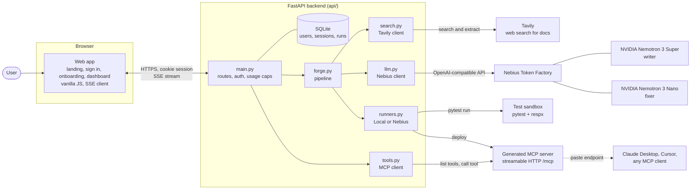
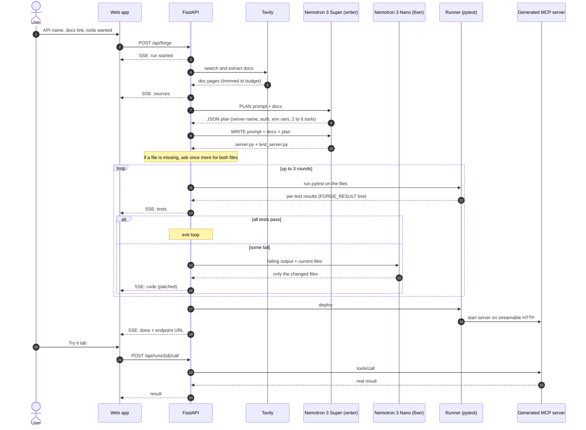

# MCP Forge

**Name any API. Get a tested, running MCP server.**

MCP Forge turns API docs into a working [Model Context Protocol](https://modelcontextprotocol.io) server. You type the name of an API. An agent finds the docs, plans the tools, writes the server and its tests, runs the tests, fixes what fails, and deploys the result. You get a live endpoint and a config block to paste into Claude Desktop, Cursor or any MCP client.

Built for the **Nebius x NVIDIA Global AI Hackathon**.

| | |
|---|---|
| Live demo | https://mcp-forge-a2r0.onrender.com/ |
| Product preview | https://claude.ai/artifact/3hyFJzx5y9RdSu1qWY9TN2 |
| Code | https://github.com/Prasannaverse13/MCP-Forge |

> The live demo is a hosted, limited version. Sign up with any email. Each account gets 3 servers per day. The free host sleeps when idle, so the first load can take about a minute. Accounts and runs reset when the host redeploys.

---

## Why this exists

Every AI agent needs tools. Tools for agents are MCP servers. Writing an MCP server for each API by hand is slow, and code written by a model alone often does not work. MCP Forge closes that gap: **the code is only accepted when its tests pass**, and a second model repairs the failures.

---

## Architecture



Four parts:

1. **Web app** is one static page. It signs the user in, starts a run and draws the live pipeline from a server sent event stream.
2. **FastAPI backend** handles accounts, saved runs, usage caps and the forge pipeline.
3. **Models** run on Nebius Token Factory. Nemotron 3 Super writes. Nemotron 3 Nano fixes. Tavily supplies the docs.
4. **Runner** runs the generated tests and starts the generated server. The default runner is local. A Nebius Serverless runner is written too.

---

## How it works, step by step



### 1. Docs (Tavily)
The user gives an API name and, optionally, a docs link. `search.py` first extracts the docs link with Tavily Extract. Then it runs an advanced Tavily Search limited to the docs domain. If that gives fewer than two pages, it searches the open web. The text is trimmed to a budget (`FORGE_MAX_DOC_CHARS`, default 14000) so the model prompt stays small. The pages used are shown in the UI as sources.

### 2. Plan (Nemotron 3 Super)
The writer gets the docs and returns JSON only: the server name, how the API authenticates, the env vars it needs and 2 to 6 tools. Each tool has a name, a description and an input schema.

### 3. Write (Nemotron 3 Super)
The writer returns exactly two files in `file:NAME` blocks: `server.py` (a FastMCP server) and `test_server.py` (pytest tests with HTTP mocked by respx). If the model skips a file, the pipeline logs a warning and asks once more with an explicit "return both files" prompt.

### 4. Test (runner)
The runner copies the files plus a small harness `conftest.py` into a temp folder and runs `pytest`. The harness prints one `FORGE_RESULT` JSON line with each test name, outcome and error text. The UI shows every test live.

### 5. Fix (Nemotron 3 Nano)
If tests fail, the fixer gets the failure report and the current files. It returns **only the files it changed**. The fix prompt forbids weakening an assert just to make it pass. If the fixer returns no files, the writer model is used as a fallback. This repeats for up to 3 rounds (`max_rounds`).

### 6. Deploy
When the tests pass, the runner starts the server with `mcp.run(transport="streamable-http")` and returns its URL. The run is saved and the page shows the endpoint, the files, the test report and a ready client config.

### 7. Use it
- **Try it tab:** the backend connects to the live server with the MCP Python client, lists its tools and lets you call them from a form.
- **Connect tab:** copy the endpoint and the config block into Claude Desktop, Cursor or any MCP client.
- **Download:** `GET /api/runs/{id}/zip` gives the files as a zip.

---

## Integrations

| Integration | What it does here | Where in code |
|---|---|---|
| **Nebius Token Factory** | Hosts the models. The backend calls it through the OpenAI compatible API at `https://api.tokenfactory.nebius.com/v1/`. Model ids are read from `/v1/models`. | `api/llm.py`, `api/config.py` |
| **NVIDIA Nemotron 3 Super** | The **writer**. Plans the tools and writes the server and tests. Chosen by default (Ultra is the second choice). | `api/llm.py`, `api/prompts.py` |
| **NVIDIA Nemotron 3 Nano** | The **fixer**. Reads failing tests and patches the code. Chosen by default. | `api/llm.py`, `api/forge.py` |
| **Tavily** | Finds and reads the API docs. Search plus Extract. Its output is the only source of truth the writer gets. | `api/search.py` |
| **Nebius Serverless AI** (jobs and endpoints) | Optional runner. Runs the tests in a Serverless Job and deploys the server as a Serverless Endpoint. Written, **not yet tested** (see status). | `api/runners.py` (`NebiusRunner`) |
| **Model Context Protocol** | The product output. Generated servers use FastMCP from the official `mcp` SDK. The backend also uses the SDK client to list and call tools. | `api/tools.py`, generated `server.py` |
| **pytest, pytest-asyncio, respx** | The gate. Generated tests mock HTTP with respx so they run without the real API or keys. | `api/harness/conftest.py` |
| **FastAPI and Server Sent Events** | The API and the live event stream to the UI. | `api/main.py` |
| **SQLite** | Accounts, sessions and saved runs. Passwords use scrypt. | `api/db.py` |
| **Render** | Hosts the public demo from `render.yaml`. | `render.yaml` |

### Model selection
Nothing is hard coded. At the start of a run the backend asks Token Factory for its model list. It picks the writer (Nemotron Super first, then Ultra) and the fixer (Nemotron Nano). To pin models, set `NEBIUS_WRITER_MODEL` and `NEBIUS_FIXER_MODEL`.

### Why two models
Writing a whole server needs a strong model. Fixing one failing assert needs a fast one. Using Nano for repair keeps each round cheap and quick, and the stronger writer is used again only when the fixer returns nothing.

---

## Accounts and saved runs

- Sign up and sign in with email and password. Passwords are hashed with scrypt.
- A session is an HttpOnly cookie `forge_session` (SameSite lax, 30 days). Only a SHA-256 hash of the token is stored.
- Every run is saved to the user's own history with its files, events and test results.
- API keys are read from the server environment. There is no key step in onboarding.

---

## API reference

| Method and path | What it does |
|---|---|
| `POST /api/auth/signup` | Create an account and start a session |
| `POST /api/auth/signin` | Sign in |
| `POST /api/auth/signout` | Sign out |
| `GET /api/me`, `PATCH /api/me` | Read or update the profile |
| `GET /api/health` | Health and runner name |
| `POST /api/forge` | Start a run. Returns `text/event-stream` |
| `GET /api/runs` | List your runs |
| `GET /api/runs/{id}`, `DELETE /api/runs/{id}` | Read or delete a run |
| `GET /api/runs/{id}/zip` | Download the generated files |
| `GET /api/runs/{id}/tools` | List the live server's tools |
| `POST /api/runs/{id}/call` | Call one tool on the live server |

Stream event types: `run`, `step`, `log`, `code`, `tests`, `sources`, `done`, `error`.

---

## Project structure

```
MCP-Forge/
├── README.md
├── LICENSE
├── render.yaml                 Render blueprint (public demo)
├── api/
│   ├── main.py                 FastAPI routes, auth, caps, static files
│   ├── forge.py                The pipeline: docs, plan, write, test, fix, deploy
│   ├── llm.py                  Nebius client, model picking, file parsing
│   ├── prompts.py              Plan, write and fix prompts
│   ├── search.py               Tavily search and extract
│   ├── runners.py              LocalRunner and NebiusRunner
│   ├── tools.py                MCP client for Try it
│   ├── db.py                   SQLite: users, sessions, runs
│   ├── config.py               Settings from the environment
│   ├── harness/conftest.py     Prints per-test results for the UI
│   ├── tests/                  Fake and replay servers used for testing
│   ├── requirements.txt
│   └── .env.example
└── web/
    ├── parts/                  Source pieces of the single page app
    ├── assemble.py             Joins the parts into src.html
    ├── build.py                Builds the final index.html
    └── index.html              What the server serves
```

---

## Run it locally

You need Python 3.11 or newer, a [Nebius Token Factory](https://tokenfactory.nebius.com) key and a [Tavily](https://tavily.com) key.

```bash
git clone https://github.com/Prasannaverse13/MCP-Forge.git
cd MCP-Forge/api
python -m venv .venv
# Windows: .venv\Scripts\activate     macOS or Linux: source .venv/bin/activate
pip install -r requirements.txt
cp .env.example .env        # then put your two keys in .env
python -m uvicorn main:app --port 8000
```

Open http://127.0.0.1:8000, create an account, pick an API and press **Forge**.

### Configuration

| Variable | Default | Meaning |
|---|---|---|
| `NEBIUS_API_KEY` | | Token Factory key (required) |
| `TAVILY_API_KEY` | | Tavily key (required) |
| `NEBIUS_WRITER_MODEL`, `NEBIUS_FIXER_MODEL` | auto | Pin model ids |
| `FORGE_RUNNER` | `local` | `local` or `nebius` |
| `FORGE_DB` | `api/forge.db` | SQLite file path |
| `FORGE_MAX_DOC_CHARS` | `14000` | Docs budget in the prompt |
| `FORGE_TEST_TIMEOUT` | `120` | Seconds before tests are killed |
| `FORGE_MAX_RUNS_PER_USER_DAY` | `0` (off) | Per account daily cap |
| `FORGE_MAX_RUNS_PER_DAY` | `0` (off) | Whole site daily cap |
| `FORGE_MAX_PARALLEL` | `0` (off) | Runs at the same time |
| `NEBIUS_PROJECT_ID`, `NEBIUS_JOB_PLATFORM`, `NEBIUS_JOB_PRESET`, `NEBIUS_BASE_IMAGE` | | Only for the Nebius runner |

### Rebuild the frontend
The page is built from `web/parts/*`:

```bash
python web/assemble.py && python web/build.py
```

### Deploy on Render
`render.yaml` is a blueprint. Create a Blueprint on Render from this repo, then set `NEBIUS_API_KEY` and `TAVILY_API_KEY`. The blueprint turns on the demo caps (3 servers per account per day plus site wide limits).

---

## Results

Real runs with real Nebius and Tavily keys:

| API | Tools | Round 1 | Final |
|---|---|---|---|
| Open-Meteo weather | 2 | 10 of 10 tests passed | 10 of 10, live, **Try it** returned real Paris weather |
| GitHub issues | 7 tests | tests failed | **7 of 7 after 2 fix rounds** by Nemotron 3 Nano |

The GitHub run is the repair proof: Nano read the failing output and patched `test_server.py` twice until every test passed.

Demo video: see the repo release or the Devpost page.

---

## Security notes

- Generated code is **not** sandboxed with the local runner. The local runner strips `NEBIUS_` and `TAVILY_` variables from the test environment and from the deployed server, but it still runs model written code on the host. Use it for development only.
- For untrusted use, run with the Nebius runner, which executes in an isolated Serverless Job.
- Sessions are HttpOnly cookies. Passwords are scrypt hashed. Session tokens are stored hashed.
- Keys live only in the server environment. They are never sent to the browser or into generated code.
- Demo caps limit spend on the public site.

---

## Honest status

- **Nebius Serverless runner:** written (`nebius ai create --type job`, `ai job get`, `ai endpoint create`, code bundle passed as a base64 env var) but **not tested end to end**. The Nebius CLI supports only Ubuntu and macOS, and the project was built on Windows. Today the public demo and all recorded runs use the local runner.
- **Render demo:** free plan. It sleeps when idle and resets accounts and runs when it redeploys. Servers it deploys listen inside the Render machine, so Try it works but the endpoint shown in the Connect tab is not reachable from outside.
- **Fixer so far:** in the recorded run, Nano fixed test files more than server code.
- **Model quirks:** the writer sometimes skips a file. The pipeline detects this and asks again.

---

## License

MIT. See [LICENSE](LICENSE).
